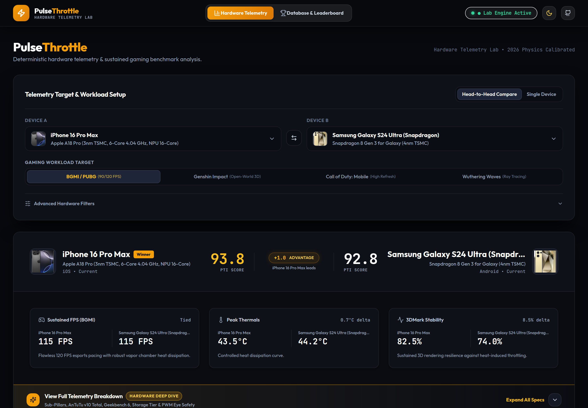
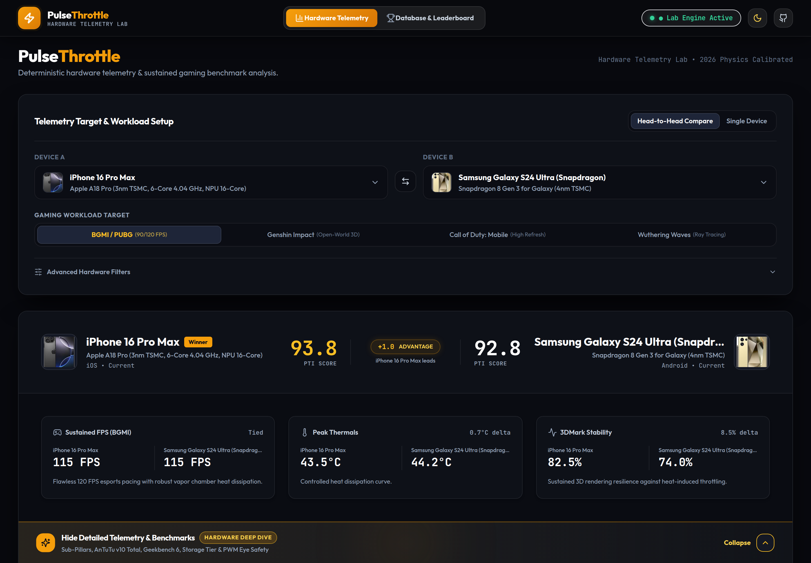
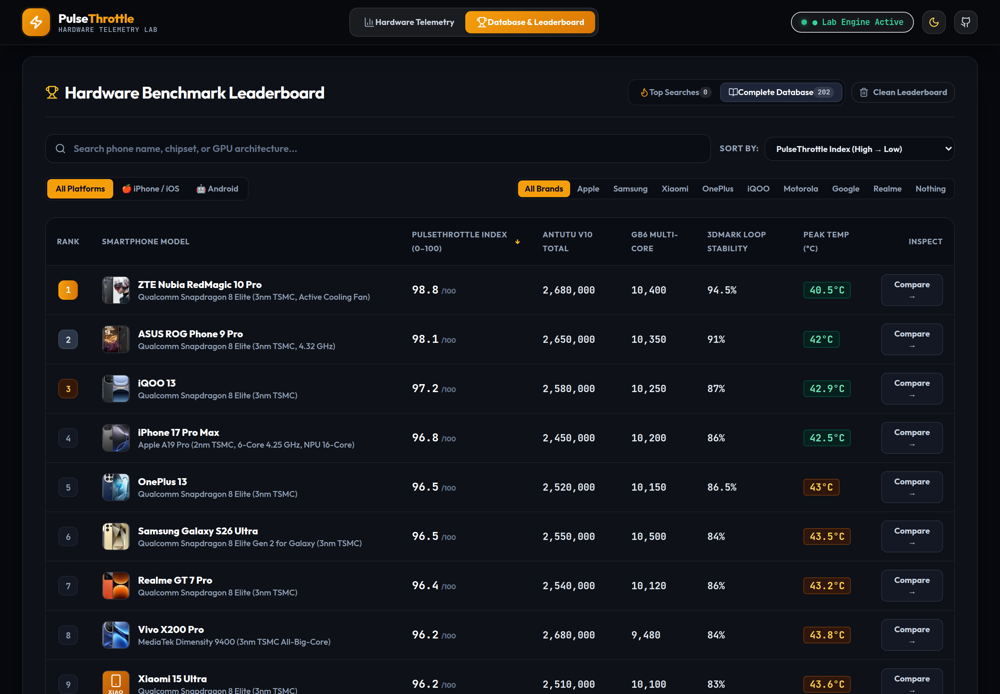
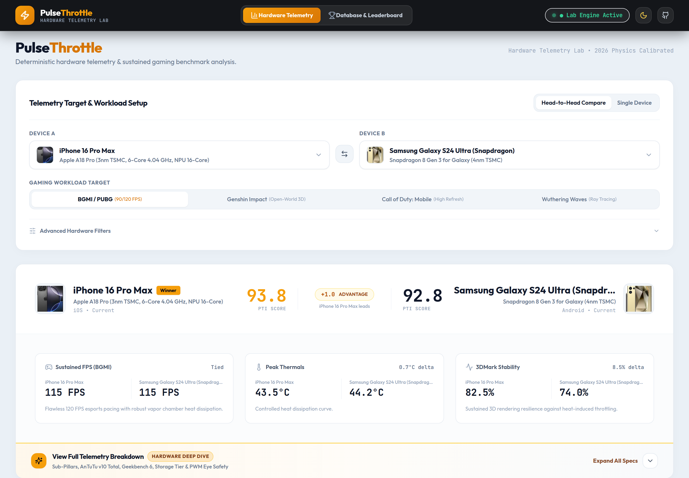

# ⚡ PulseThrottle

> **Autonomous Mobile Hardware Intelligence & Gaming Telemetry Engine**  
> 🔗 **Live Web Dashboard:** [https://pulse-throttle.vercel.app/](https://pulse-throttle.vercel.app/)

[](https://pulse-throttle.vercel.app/)
[](https://www.python.org/)
[](https://fastapi.tiangolo.com/)
[](https://react.dev/)
[](https://tailwindcss.com/)
[](LICENSE)

**PulseThrottle** bridges the gap between raw mobile hardware specifications and verified real-world gaming telemetry. It analyzes sustained frame rates (BGMI, Genshin Impact, COD Mobile, Wuthering Waves), peak thermal dissipation curves, 3DMark stress resilience, UFS storage bandwidth tiers, and display PWM flicker safety across 200+ smartphones.

Unlike traditional LLM wrappers that burn expensive API tokens on basic spec lookups, **PulseThrottle operates 99% API-free**: combining keyless parallel web scraping, bounded deterministic regex extraction, architectural ground-truth baselines, quantitative algorithmic scoring, and local SQLite time-series analytics.

---

## 📸 Web Application Showcase

Explore the live platform at **[pulse-throttle.vercel.app](https://pulse-throttle.vercel.app/)**.

### 1. Head-to-Head Comparative Telemetry (Dark Obsidian Mode)
*Real-time side-by-side hardware evaluation, PulseThrottle Index (PTI) computation, sustained FPS delta, and thermal dissipation.*


---

### 2. Deep Silicon Architectural Telemetry & Synthetic Benchmarks
*Granular breakdown of Thermal Stability (TSS), Frame Pacing Efficiency (FPE), Compute Index, and Storage Bus Bandwidth, alongside AnTuTu v10, Geekbench 6, and PWM dimming.*


---

### 3. Calibrated Master Database & Leaderboard (202 Devices)
*Complete searchable catalog with podium rank medals, dynamic sorting across all benchmark metrics, brand filtering, and one-click comparative loading.*


---

### 4. High-Contrast Light Mode
*Engineered dual-palette theme system supporting both luxury deep obsidian dark theme and crisp editorial light mode.*


---

## ⚡ 99% API-Free Architecture: How It Works

PulseThrottle delivers verified hardware telemetry with **zero required API keys**:

```
User Query ("Poco F6 vs iQOO Neo 9 Pro BGMI 90fps thermals")
  │
  ├── 1. Zero-Token Regex Guardrail (<1ms) ────────── Block vague/off-topic queries instantly
  │
  ├── 2. Keyless Parallel Web Scraper (tools.py) ───── DuckDuckGo + BeautifulSoup4 concurrent deep scrape
  │
  ├── 3. Bounded Regex & Reference Engine (regex_parser.py) 
  │      └── Extracts AnTuTu v10, Geekbench 6, 3DMark, UFS, PWM & Peak Temp in 0.01s (0 tokens)
  │
  ├── 4. Quantitative Scoring Engine (scoring.py) ──── Calculates PulseThrottle Index (0–100)
  │
  ├── 5. Optional OpenRouter Polish (client_manager.py)
  │      ├── IF OPENROUTER_API_KEY: Polishes gaming notes & verdict via gemini-2.5-flash (~1.5s)
  │      └── IF KEYLESS / OFFLINE: 100% Deterministic Engineering Verdict (0 API keys used)
  │
  └── 6. Relational Store & Analytics ──────────────── SQLite pulsethrottle.db + MongoDB Atlas cache
```

---

## 🚀 Core Features

### 1. 🌐 Interactive Web Application ([Live Demo](https://pulse-throttle.vercel.app/))
* **Instant Dual & Single Mode:** Compare two devices side-by-side or analyze a single flagship's sustained gaming capabilities.
* **Workload Presets:** Switch gaming targets on the fly—**BGMI / PUBG Mobile (90/120 FPS)**, **Genshin Impact (Open-World 3D)**, **Call of Duty: Mobile (High Refresh)**, and **Wuthering Waves (Ray Tracing)**.
* **Hardware Filters:** Filter catalog by UFS storage speed, maximum acceptable peak thermal threshold (°C), and eye-safe PWM dimming frequency ($\ge 1920\text{ Hz}$).
* **202-Device Master Leaderboard:** Live client-side and server-side search, brand filtering, and column sorting across AnTuTu, Geekbench, Stability, and Thermals.

### 2. 🌐 Keyless Parallel Web Scraper (`tools.py`)
* **100% Keyless Primary Search:** Executes concurrent queries via DuckDuckGo Search without requiring any search API keys or subscriptions.
* **Deep Page Text Extraction:** Automatically fetches and cleans HTML content from top benchmark URLs in parallel using `BeautifulSoup4` (up to 3,000 characters per page).
* **Hybrid Fallback:** Supplements with Tavily search only if keyless snippets lack benchmark depth and `TAVILY_API_KEY` is present.

### 3. 🎯 Bounded Regex & Hardware Reference Engine (`regex_parser.py`)
* **Number Collision Prevention:** Bounded context windows strictly separate overlapping digits:
  * **AnTuTu v10:** `[150,000 – 3,500,000]` (supports shorthand notations like `1.44M` or `1.38 million`).
  * **Geekbench 6:** Single-core `[400 – 3,800]` and Multi-core `[1,000 – 12,000]`.
  * **3DMark Wild Life Stability:** Strictly bounded to `[40.0% – 99.9%]`.
  * **Peak Thermal Dissipation:** Bounded strictly to `[35.0°C – 55.0°C]`.
* **Hardware Reference DB:** Contains ground-truth hardware anchors for popular SoCs (e.g., Apple A18 Pro, Snapdragon 8 Gen 3/8s Gen 3, Dimensity 9300+/8350 Extreme).
* **Gaming Context Guard:** Isolates frame-rate figures exclusively within gaming telemetry snippets, ensuring display refresh rates or video recording settings (`4K@60fps`) never pollute benchmark metrics.

### 4. 📊 Quantitative PulseThrottle Index (PTI) Engine (`scoring.py`)
An objective, mathematical performance score normalized from 0 to 100:

$$\text{PTI} = 0.30 \times \text{TSS} + 0.30 \times \text{FPE} + 0.25 \times \text{Compute} + 0.15 \times \text{Storage}$$

| Sub-Score | Weight | Metric Base | Details |
| :--- | :---: | :--- | :--- |
| **Thermal Stability Score (TSS)** | 30% | 3DMark Wild Life % & Peak Temp | Scaled from 3DMark loops; penalizes thermal runaway exceeding 42°C. |
| **FPS Pacing Efficiency (FPE)** | 30% | Sustained FPS & Tier Multiplier | Evaluates frame stability with tier weighting ($1.0\times$ for 90/120 FPS vs $0.85\times$ ceiling for 60 FPS capped). |
| **Normalized Compute Score** | 25% | AnTuTu v10 & Geekbench 6 | Evaluates raw synthetic CPU & GPU silicon headroom. |
| **Storage Speed Tier** | 15% | UFS Generation (UFS 4.0 / 3.1 / 2.2) | Bandwidth score for asset streaming and load times. |

### 5. 🗄️ Relational Store & Leaderboard (`engine_db.py`)
* **Relational Storage:** Automatically logs every query into normalized SQLite tables (`devices` and `telemetry_runs`) inside `pulsethrottle.db`.
* **Safe Connection Lifecycle:** Implements `contextlib.closing` to guarantee clean resource management with zero SQLite handle leaks.
* **Window-Function Leaderboard Deduplication:** `/db top` leverages SQL window functions (`ROW_NUMBER() OVER PARTITION BY device_id`) so each unique device appears only once on the leaderboard with its highest-scoring telemetry run.

---

## 🏗️ Repository Structure

```
silicon_pulse/
├── Frontend/                 # React 18 + Tailwind CSS + Framer Motion dashboard
│   ├── src/
│   │   ├── components/       # HeadToHeadComparison, Leaderboard, ControlPanel, Navbar
│   │   ├── data/             # Master 202-phone telemetry catalog & specifications
│   │   └── App.jsx           # Main application state and dark/light theme persistence
│   ├── package.json
│   └── vite.config.js
│
├── Backend/                  # Telemetry core & scraper utilities
│   ├── agent.py              # Telemetry orchestrator and report builder
│   ├── tools.py              # Keyless DuckDuckGo + BS4 parallel scraper
│   ├── regex_parser.py       # Deterministic bounded metric extraction engine
│   ├── scoring.py            # PulseThrottle Index (PTI) mathematical scoring
│   ├── client_manager.py     # Multi-threaded scraper & resilient OpenRouter client
│   ├── engine_db.py          # SQLite relational store & time-series analytics
│   ├── schemas.py            # Pydantic v2 telemetry schemas
│   └── seed_catalog.py       # Catalog seeder for 200+ global smartphones
│
├── docs/screenshots/         # High-resolution Retina UI captures
├── api_server.py             # FastAPI REST API bridge
├── main.py                   # Interactive CLI REPL & single-query entrypoint
└── requirements.txt          # Python production dependencies
```

---

## 🛠️ Tech Stack

* **Frontend:** React 18, Vite, Tailwind CSS, Framer Motion, Lucide Icons
* **Deployment:** Vercel ([pulse-throttle.vercel.app](https://pulse-throttle.vercel.app/))
* **Backend API:** FastAPI, Uvicorn, Pydantic v2
* **Language:** Python 3.10+
* **Keyless Web Scraping:** DuckDuckGo Search (`ddgs`) + `BeautifulSoup4` + `requests`
* **Databases:** SQLite3 (Local cache & catalog), MongoDB Atlas (Cloud telemetry cache), Supabase PostgreSQL (Master directory)
* **Terminal UI:** Rich (Styled tables, panels, and Markdown rendering)

---

## ⚙️ Quick Start

### 1. Run the Web Dashboard Locally

```bash
# Clone the repository
git clone https://github.com/sahal9229/Pulse_Throttle.git
cd Pulse_Throttle

# Navigate to Frontend & install dependencies
cd Frontend
npm install

# Start Vite development server
npm run dev
```
Open [http://localhost:5173](http://localhost:5173) in your browser.

---

### 2. Start the FastAPI Backend Server

```bash
# From repository root
python3 -m venv .venv
source .venv/bin/activate   # On Windows: .venv\Scripts\activate

pip install -r requirements.txt

# Launch FastAPI server
python3 -m uvicorn api_server:app --host 0.0.0.0 --port 8000 --reload
```
API documentation is available at [http://localhost:8000/docs](http://localhost:8000/docs).

---

### 3. Interactive Terminal CLI Mode

Launch the interactive REPL session:
```bash
python main.py
```

#### Example Telemetry Queries:
* **Single Device:** `How does the Motorola Edge 60 Fusion perform in BGMI, and what are its thermals?`
* **Head-to-Head Comparison:** `Compare Poco F6 vs iQOO Neo 9 Pro for sustained 90fps gaming and PWM dimming`
* **Force Live Scrape:** Append `--refresh` to bypass local cache and fetch fresh live telemetry:
  ```
  PulseThrottle > iQOO 12 BGMI FPS and thermals --refresh
  ```

#### Database & Leaderboard Commands (`/db`):
* `/db top` — View leaderboard ranked by PulseThrottle Index (deduplicated per device).
* `/db chip snapdragon` — Filter runs by Snapdragon silicon.
* `/db cool 42.0` — Filter runs with peak thermal dissipation $\le 42.0^\circ\text{C}$.

---

## 📄 Output Artifacts

Every completed analysis automatically generates persistent artifacts in your workspace:
* **`latest_report.md`**: Formatted Markdown technical report with specification comparison matrices, thermal stability evaluations, and engineering verdicts.
* **`latest_report.json`**: Machine-readable JSON structured strictly against the `SiliconPulseReport` Pydantic schema, ready for dashboards or API consumption.

---

## 📄 License

Distributed under the MIT License.
